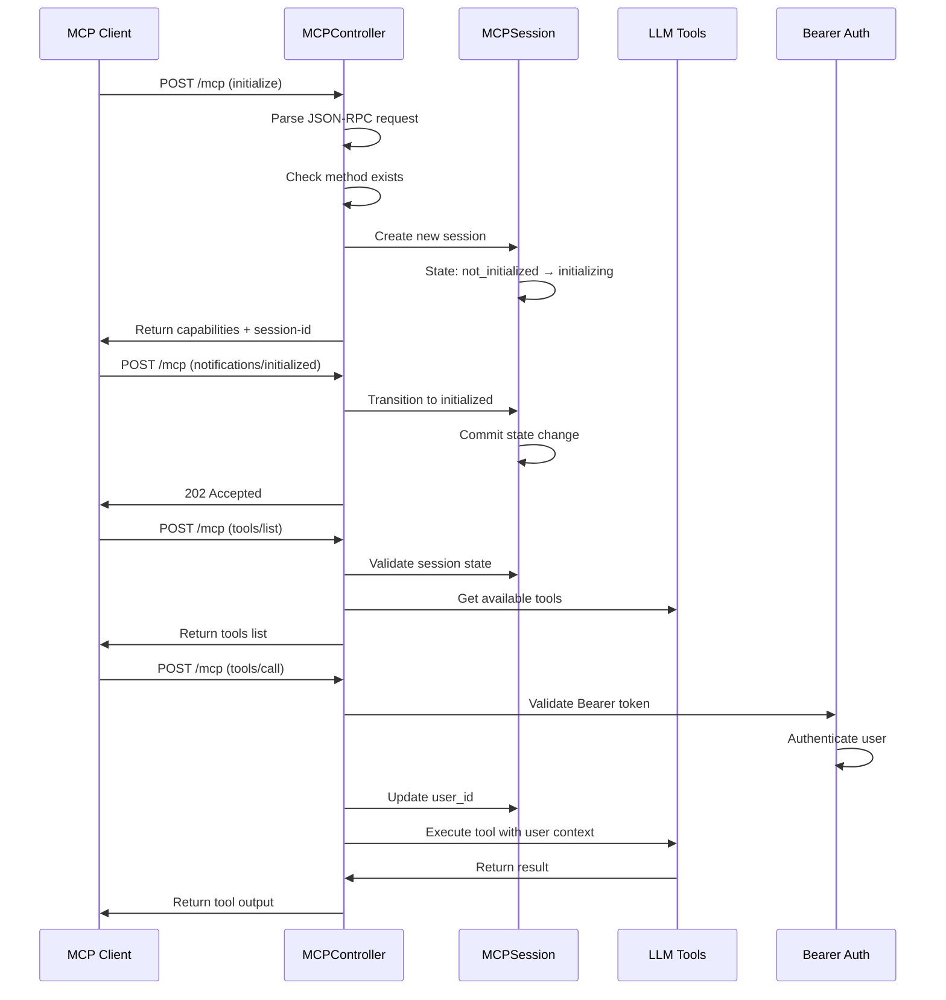
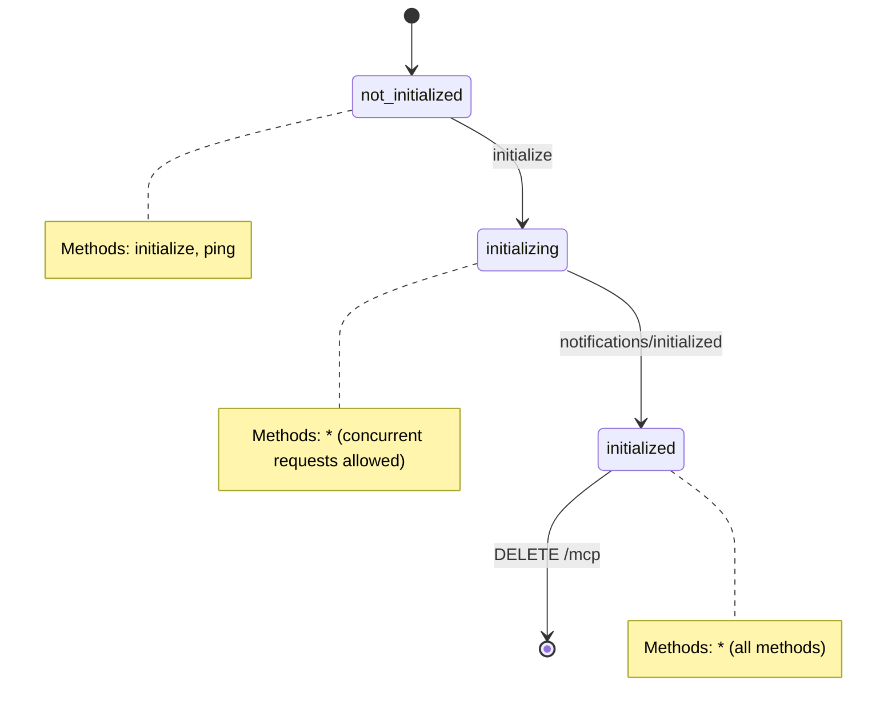

# MCP Server Technical Guide

## Architecture Overview

The MCP server implements a stateful JSON-RPC 2.0 server that bridges MCP clients with Odoo's LLM tool system.

### Core Components

- **MCPController**: HTTP endpoint handler (`/mcp`)
- **MCPSession**: Session state management model
- **MCPServerConfig**: Server configuration model
- **Bearer Auth**: API key authentication decorator

## Request Flow

## Session State Machine

## Key Design Decisions

### Concurrent Request Handling

- `initializing` state allows all methods to handle Claude Desktop's parallel discovery requests
- Explicit `session._cr.commit()` ensures immediate state visibility

### Authentication Flow

- `tools/call` requires Bearer authentication
- Session user_id updated on first authenticated request
- Tools execute with authenticated user's Odoo permissions

### Error Handling

- Early method validation prevents unnecessary session lookups
- JSON-RPC 2.0 compliant error responses
- Proper HTTP status codes (200 for JSON-RPC, 400/404 for transport errors)

## Performance Optimizations

1. **Method Existence Check**: `_is_callable()` validates handlers before session operations
2. **Indexed Lookups**: `session_id` field has database index for fast session retrieval
3. **Minimal Logging**: Production mode logs only warnings and authentication events
4. **State Transitions**: Direct database commits prevent race conditions

## Configuration

- **Mode**: Stateful (recommended) vs Stateless
- **Protocol Version**: Auto-negotiation with MCP 2025-06-18 support
- **External URL**: Override for Docker/container environments

## Security Model

- Bearer token authentication via Odoo's `res.users.apikeys`
- User context binding: `request.update_env(user=authenticated_user)`
- Tool access groups: `llm.tool.allowed_group_ids` (declared in `llm`; written by
  `@llm_tool(groups=...)` or the MCP Hub form). Both `tools/list` and
  `tools/call` apply `_mcp_visibility_domain()`; empty means administrators only
- ACL enforcement for `model_method` / `server_action` tools: they run as the
  authenticated user, so Odoo access and record rules apply
- Remote (`mcp` executor) tools: proxied with the `llm.mcp.client` credentials,
  so Odoo ACLs do not bound the remote response; the access-group check is the
  gate
- Session isolation: Each session tracks its own user context

## File Service (`attachment_*`)

`ir.attachment` is the file identity; `attachment_id` is its id. The server adds no
token table: both directions use
`odoo.tools.misc.limited_field_access_token`, which binds an HMAC signature to
the attachment id, field and expiry.

- **Upload**: `attachment_stage_upload` creates an unbound empty attachment and a
  `llm.mcp.file.upload` staging row, then returns
  `/mcp/files/<attachment_id>?access_token=...` (scope
  `llm_attachment_upload`, 1 h). The relay controller verifies the signature,
  claims `pending` → `uploaded` atomically, and writes `raw` bytes.
- **Commit**: `attachment_commit_upload` optionally binds `res_model`/`res_id` as
  the caller (core enforces write access to that record). Unbound files stay
  creator/admin-only.
- **Download**: `attachment_get_download_url` checks `attachment.check_access`
  and returns a `/web/content/.../raw?access_token=...` URL signed with scope
  `binary` (10 min). Serving and token validation are Odoo core behaviour.
- **Cleanup**: hourly cron removes expired `pending`/`uploaded` staging rows and
  their attachments; committed attachments are never removed.
- **Limits**: `llm_mcp_server.max_file_upload_mb` (default 64); multipart and
  replayed uploads are rejected.

Detailed design: `docs/FILE_SERVICE.md`.
